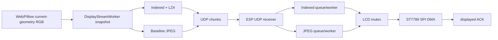

# MJPEG 与 Indexed 双模式架构

## 1. 目标

同一 Host 和固件保留两条适配不同内容的完整帧路径，并允许无重启热切换：Indexed 负责低色锐利 UI，MJPEG 负责高色和连续画面。



## 2. 共享与隔离

共享：

- 当前 240x320 或 320x240 源图、DisplayStreamWorker、基础包头和 UDP 端口。
- transport control、`transport_epoch` 和 ESP 状态通道。
- LCD 驱动、显示互斥锁、80 MHz SPI DMA 和 displayed ACK。

隔离：

| 项目 | Indexed | MJPEG |
|---|---|---|
| 编码 | I1/I2/I4/I8 调色板 + LZ4 | Baseline JPEG |
| ESP 处理 | LZ4 解压、索引展开 | `esp_new_jpeg` block decode |
| 最大压缩帧 | 80 KiB | 65535 B |
| 画质风险 | 量化、调色板变化 | DCT、色度子采样 |
| 典型内容 | 文字、线条、离散颜色 | 视频、照片、渐变 |

两个 worker 不合并为一个复杂解码器；它们只共享模式控制和 LCD 所有权。

## 3. 运行时切换

1. Host 更新目标模式并递增 epoch。
2. 清理旧模式发送缓存和 pacing 状态。
3. 连续请求关键帧并发送 mode/epoch 控制包。
4. ESP 更新活动 mode/epoch，释放旧接收状态和队列。
5. worker 在拿到 LCD mutex 后再次检查 mode/epoch。
6. 迟到包、旧 worker 结果和旧 ACK 被忽略。

只切换 Host 编码器不足以保证正确性；没有 epoch 会出现旧页闪回、旧模式覆盖和两个 worker 竞争 LCD。

## 4. Host 调度

```text
基础渲染周期        1/45 s
Indexed 目标周期    1/30 s
MJPEG 发送上限      30 FPS
场景变化关键帧      6 frames
```

Indexed 使用绝对 deadline 调度；MJPEG 只补足距离上次发送的剩余时间。截图、编码、pacing 和 UDP 发送都在 `DemoState` 锁外执行。

## 5. 场景 profile

- 产品页在当前目标模式下持续发送完整帧，因此动效和静态变化使用同一时序。
- Video 自动使用适合连续帧的发送 profile；内容应选择 MJPEG。
- 色彩诊断图绕过 Tone，但不绕过目标编码器。
- 切页会主动唤醒 worker，不等待下一个常规周期。

## 6. LCD 控制

背光使用 LEDC PWM，不占用 LCD SPI。Gamma 使用 ST7789 `GAMSET` panel IO 命令，必须与画面 DMA 共用显示互斥锁。同一 Gamma 值会直接跳过，避免每次场景控制包都访问 SPI。

该约束修复了快速连续切页时 worker 永久停在 LCD submit、`displayed_frame_id` 和 LCD FPS 冻结的问题。

## 7. 正确性条件

- Host 和 ESP mode/epoch 必须一致。
- `displayed_frame_id` 只在 LCD 完成后前进。
- 稳定时 lag 不持续扩大，完整帧队列最终回到 0。
- 模式切换可丢弃旧帧，但不能让旧帧重新显示。
- Preview 读取缓存，不参与物理发送调度。

性能数据和压力测试只在 [A/B 文档](./05-performance-ab-test-guide.md) 维护。
