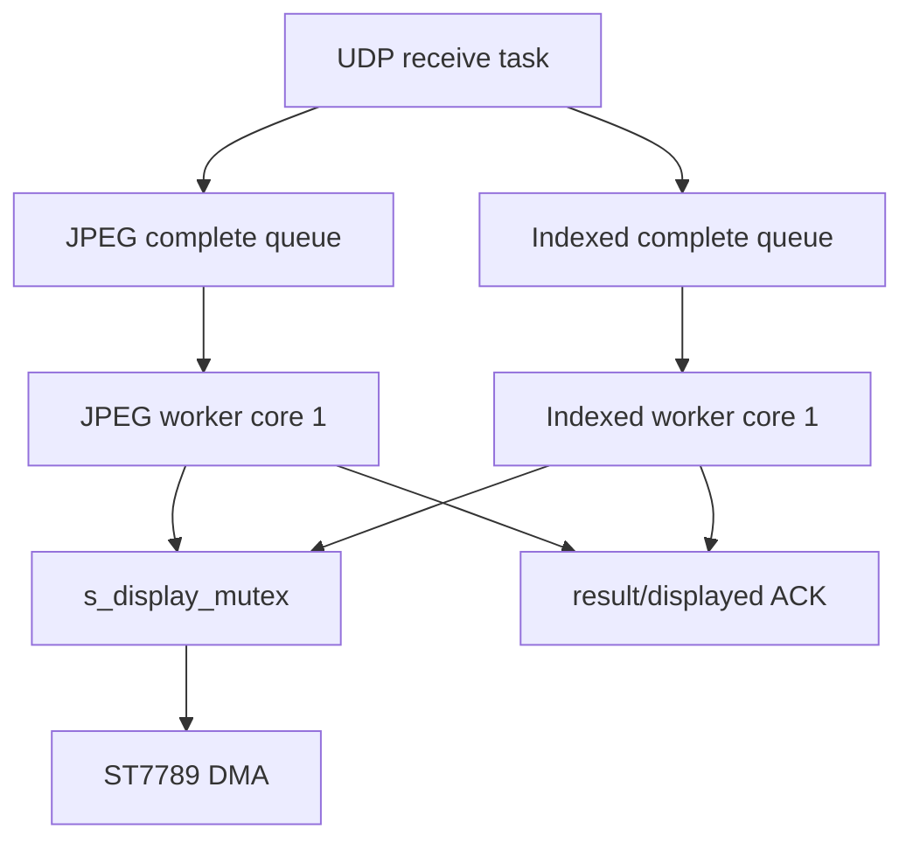

# ESP32 接收、LCD DMA 与 ACK

## 1. 硬件

```text
ESP32-S3 + PSRAM
ST7789 240x320 portrait / 320x240 landscape
SCL/SCLK GPIO 12
SDA/MOSI GPIO 11
CS GPIO 10
DC GPIO 8
RST GPIO 7
BL GPIO 6
SPI pixel clock 80 MHz
transaction queue depth 10
RGB565 big-endian
panel inversion enabled
```

背光为 5 kHz、10 bit LEDC PWM。默认 Gamma 1.8，由 ST7789 `GAMSET` 控制。

## 2. 任务和所有权



接收任务只校验 CRC、解析 mode/epoch、组帧和入队，不同步做完整解码或刷屏。两个 worker 即使同属 core 1 也必须通过 mutex 串行 LCD。

Panel IO 命令同样属于 LCD 所有权。Gamma 只在值变化时发送，并在 mutex 内执行；否则可能与 `esp_lcd_panel_draw_bitmap()` 竞争，导致 worker 卡在 submit、LCD FPS 和帧号永久冻结。

## 3. 网络与队列

```text
UDP recv buffer             2300 B
SO_RCVBUF                   48 KiB
MJPEG/Indexed payload       1400 B
MJPEG frame buffers         3 x 65535 B
Indexed frame buffers       4 x 80 KiB
complete queue              2 per mode
result queue                4 per mode
```

1400 B payload避免常见 1500 MTU 的 IP 分片。Host 与固件必须同时改变 payload/offset 常量；扩大 socket buffer不能修复协议错位。

Indexed 的四个帧缓冲覆盖接收任务预占 1 个、worker 占用 1 个和完整队列 2 个。队列保持很浅，实时显示优先新帧；队列过深只会增加延迟。

## 4. MJPEG worker

- `esp_new_jpeg 0.5.0`。
- `JPEG_PIXEL_FORMAT_RGB565_BE`、block decode。
- decoder handle 在 pipeline 初始化时创建并长期复用。
- 三个 65535 B JPEG 接收帧缓冲。
- 两个 DMA-capable 16 行输出缓冲；当前最多一个 LCD transaction in flight。
- 不使用 153600 B 完整 RGB565 decode buffer。

## 5. Indexed worker

- 四个 80 KiB 压缩帧缓冲。
- I1/I2 解压到 19200 B 内部 RAM fast buffer。
- I4/I8 解压到 76800 B extended buffer，优先 PSRAM。
- 每次展开最多 16 行 RGB565_BE，并在上一块 DMA 时准备下一块。
- I8 使用扩展 32 位压缩长度约定，禁止按 16 位截断。

## 6. LCD 局部缓冲

`lcd_display.c` 有两个 40 行通用 DMA buffer和一个 PSRAM RGB565 framebuffer；MJPEG/Indexed worker另有各自两个 16 行 block buffer。当前完整帧主路径直接提交 block，不需要先写完整 RGB565 framebuffer再全屏复制。

DMA 和 block buffer 以最大行宽 320 分配，运行时循环和 LCD window 使用当前宽高。横竖屏像素总数相同，因此完整 framebuffer 仍为 76800 像素，不需要第二份横屏 framebuffer。

方向变化由 display mode packet 携带，并复用 transport epoch 完成原子切换。ESP32 先在 LCD mutex 内丢弃旧方向的 MJPEG/Indexed 完整帧队列，再调用 ST7789 `swap_xy`/`mirror`、清屏并接受新方向帧。不能只改变 Host 图片尺寸而不递增 epoch，否则旧队列可能在新方向下刷屏。

更多缓冲不必然提高 FPS。ST7789 SPI 带宽、面板事务、解码和 PSRAM访问均可能成为瓶颈；只能用 A/B 数据决定。

## 7. displayed ACK

worker 完成该帧 LCD pipeline并返回 `ESP_OK` 后，固件才更新 `s_displayed_frame_id`。ACK 表示“物理刷屏完成”，不是“UDP 收到”或“已入队”。

Host 用它计算 LCD FPS、lag，并为 MJPEG Preview 选择已显示帧。

Indexed Host 允许最多 3 个未显示帧，对应 ESP 的 worker 1 帧和完整队列 2 帧；第 4 帧最多等待 ACK 500 ms。ESP 接收循环每 2 ms 回收 worker result并发送 ACK，旧 UDP tile 的空闲合并刷新仍独立保持 20 ms。不要重新把两个时间常量合并，否则 ACK 等待会被无故串入实时链路。

## 8. 计数器和 worker stage

通用：Host `frame_id/fps`、ESP `displayed_frame_id/display_fps`、`decode/lcd/frame_avg_us`。

每个模式有 queued、incomplete、dropped、worker frame/stage；Indexed另有 no-buffer 和 queue depth。稳定窗口看增量，不以启动以来累计值直接判错。

worker stage 长时间固定且 displayed frame不增长表示任务卡在特定阶段。例如 Indexed stage 4 是 LCD submit，stage 5 是等待 DMA；应先检查 LCD 所有权和完成信号，而不是修改网络 NACK。

## 9. 日志

性能测试默认关闭 ESP 日志。逐包格式化和串口输出会干扰 UDP 与 worker 调度。长期观察使用状态计数器，只在定位 reject、decode 或 panel IO错误时短期开启日志。
