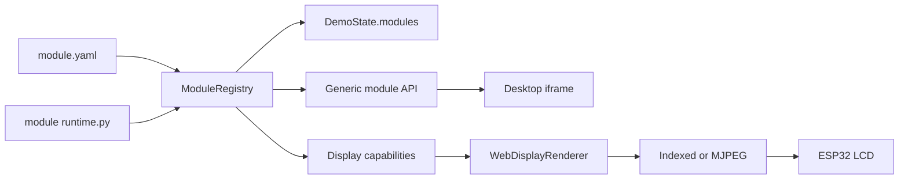

# ESPAgent 模块开发指南

## 1. 架构目标

模块系统用于把可选业务能力从 Host 主程序中拆开。一个模块应自行拥有 Manifest、Python Runtime 和桌面 UI；需要 ESP32 页面时，再声明设备场景能力。

当前只加载 `apps/demo_host/modules/` 下的可信内置模块，不是可从网络安装的第三方插件系统。UDP、Indexed/MJPEG、Display worker、Hermes、Home Assistant 和 LCD 固件仍属于 Host 公共基础设施。



关键边界：

| 领域 | 文件 |
|---|---|
| Manifest、发现、生命周期、场景能力 | `apps/demo_host/espagent_demo/module_runtime.py` |
| 通用模块 HTTP API | `apps/demo_host/espagent_demo/server.py` |
| 设备渲染适配 | `apps/demo_host/espagent_demo/web_renderer.py` |
| 模块状态镜像 | `apps/demo_host/espagent_demo/state.py` |
| 桌面导航和 iframe | `apps/demo_host/desktop_ui/` |
| 模块实现 | `apps/demo_host/modules/<module-id>/` |

`server.py` 和 `web_renderer.py` 不应再按模块 ID 增加分支。

## 2. 目录结构

```text
apps/demo_host/modules/<module-id>/
|- module.yaml
|- runtime.py
`- ui/
   |- app/
   |  |- index.html
   |  |- app.css
   |  `- app.js
   `- esp32/
      `- index.html
```

已有模块：

- `builtin.codex-usage`：Codex 额度状态，设备场景使用统一 Chromium UI。
- `builtin.desktop-mirror`：桌面副屏，Runtime 直接提供图像帧。
- `builtin.ws2812b`：ESP-01S / ESP32-S3 SuperMini WLED 灯条控制，无设备场景。

`espagent_demo/codex_usage.py`、`desktop_mirror.py` 和 `ws2812b.py` 仅是旧导入路径的兼容层，业务实现位于对应模块目录。

## 3. Manifest

```yaml
id: builtin.weather
name: 天气
version: 0.1.0
description: 显示当前天气
module_type: builtin
enabled: true

navigation:
  order: 40
  icon: weather
  pinned: true

runtime:
  type: python_module
  entry: runtime.py:WeatherRuntime

frontend:
  app_pages:
    - id: overview
      path: ui/app
      default: true
  esp32_scenes:
    - id: weather
      path: ui/esp32
      scene_key: weather
      width: 240
      height: 320
      renderer: frame_source
      transport:
        transport_mode: indexed
        indexed_bpp: 4
      default: true

permissions:
  - network.weather_api
```

规则：

- `id` 和 `scene_key` 必须全局唯一。
- 新模块使用 `runtime.type: python_module`；入口文件必须位于模块根目录内，路径越界会被拒绝。
- `python_builtin` 和 `espagent_demo.<module>:<class>` 只用于兼容主程序内置入口。
- `app_pages` 和 `esp32_scenes` 均可为空；多页面时应明确一个 `default: true`。
- Manifest 的 `enabled` 是首次运行默认值；用户在桌面应用中的开关优先于该默认值。
- `permissions` 当前用于声明和审查，尚未形成强制权限沙箱。
- 新增模块或修改 Manifest 后需要重启 Host。

## 4. Runtime 接口

Runtime 构造函数必须接收 `on_state`，需要模块目录时可同时接收 `context`：

```python
class WeatherRuntime:
    def __init__(self, *, on_state, context):
        self._on_state = on_state
        self._root = context.root
        self._state = {"status": "stopped", "temperature": None}

    def start(self) -> None:
        self._state["status"] = "ready"
        self._on_state(dict(self._state))

    def close(self) -> None:
        self._state["status"] = "stopped"

    def snapshot(self) -> dict[str, object]:
        return dict(self._state)

    def invoke(self, action: str, payload: dict[str, object]) -> dict[str, object]:
        if action != "refresh":
            raise ValueError(f"unsupported action: {action}")
        return self.snapshot()
```

要求：

- `start()` 不得阻塞 Host lifespan；持续工作放入模块自己的 daemon thread。
- `close()` 必须停止线程、子进程和网络客户端。
- `snapshot()` 返回副本，不暴露可变内部对象。
- 状态变化后调用 `on_state(snapshot)`，不要直接操作桌面 DOM、`DemoState` 或 Display worker。
- 错误状态必须脱敏，不得暴露 token、账号 ID 或完整服务响应。

Registry 生命周期与模块业务状态彼此独立：

```text
registered -> starting -> running -> stopped
                       `-> failed
registered -> disabled
```

## 5. 通用 API

```text
GET  /api/modules
GET  /api/modules/{module_id}/state
POST /api/modules/{module_id}/actions/{action}
POST /api/modules/{module_id}/activate
POST /api/modules/{module_id}/enabled
```

模块桌面页使用自身状态和动作 API。静态资源路径为：

```text
/module-assets/{module_id}/app/
/module-assets/{module_id}/esp32/
```

激活请求的 `target` 支持 `app`、`esp32` 和 `app_and_esp32`。Host 根据 Manifest 设置 `active_module_id` 与 `scene_key`，不识别具体模块名称。

启用状态请求为 `{"enabled": true|false}`。禁用会关闭 Runtime、从固定导航和快捷键场景中移除模块；如果设备正在显示该模块，Host 会先退回 Link 页面。再次启用时 Registry 会重新构造 Runtime，而不是复用已经 `close()` 的对象。

Windows 默认把用户选择保存在 `%LOCALAPPDATA%/ESPAgent/modules.json`。可通过 `ESPAGENT_MODULE_SETTINGS` 指定其他路径。该文件只保存启用状态，不修改模块自己的 `module.yaml`。

安装版中的内置模块随应用分发，安装目录视为只读；模块启用状态和其他可变数据必须写入 `%LOCALAPPDATA%\ESPAgent`。当前系统不支持把新模块复制到安装目录后动态安装，模块开发与注册仍在源码树中完成。

## 6. ESP32 场景能力

`renderer` 支持三种模式：

- `frame_source`：推荐给独立模块。Runtime 直接提供 Pillow `Image`，不修改 Host 场景分支。
- `host_web`：场景已集成进统一 Chromium 设备 UI 时使用，例如 Codex。
- `fallback`：交给主程序 Pillow renderer，主要服务已有核心页面和故障回退。

`frame_source` Runtime 可实现以下首选接口：

```python
def set_display_scene(self, scene_key: str | None, width: int, height: int) -> None: ...
def display_frame_pending(self, scene_key: str) -> bool: ...
def display_frame(self, scene_key: str) -> Image.Image: ...
def display_transport_profile(self, scene_key: str) -> dict[str, object]: ...
```

Registry 兼容旧接口：

```python
set_output_size(width, height)
set_scene_active(active)
has_pending_frame()
current_frame()
```

动态 `display_transport_profile()` 会覆盖 Manifest 的场景默认值。允许字段为：

```text
transport_mode: mjpeg | indexed
jpeg_quality: 30..95
jpeg_subsampling: 420 | 422 | 444
indexed_bpp: 1 | 2 | 4 | 8
```

模块只描述场景要求。帧调度、背压、Indexed/MJPEG 编码、UDP、ACK、全刷与 LCD DMA 仍由 Host 和固件统一负责。新增常规 `frame_source` 模块时，不应修改 `server.py` 或 `web_renderer.py`。

## 7. 桌面 UI 约束

- 模块页运行在独立 iframe 中，不依赖桌面壳内部 CSS 选择器。
- 外部状态使用 `textContent` 或安全 DOM API，不拼接到 `innerHTML`。
- 数字输入在编辑期间不能被轮询状态覆盖。
- 隐藏 iframe 仍可能运行计时器，页面不可见时应暂停高频预览与轮询。
- 低频状态按需更新，不要按显示帧率调用模块 API。

## 8. 测试

模块定向测试：

```powershell
Set-Location apps\demo_host
.\.venv\Scripts\python.exe -m pytest -q `
  tests\test_module_runtime.py `
  tests\test_web_renderer.py `
  tests\test_server.py
```

完整回归：

```powershell
.\.venv\Scripts\python.exe -m pytest -q tests
```

至少覆盖：

- Manifest 发现顺序、重复 ID 和重复 `scene_key` 拒绝。
- 模块目录 Runtime 加载、`context.root`、生命周期和错误状态。
- 启用状态持久化、禁用关闭、启用重建和禁用模块激活拒绝。
- 通用模块状态、动作、激活和静态资源 API。
- `frame_source` 的横竖屏尺寸、pending 帧和关闭停用。
- 动态传输配置与设备场景切换。
- 模块页打开时 Host/LCD FPS 不持续下降。

## 9. 后续边界

当前仍是可信内置模块系统，尚未实现运行时安装、签名、依赖解析、权限强制、卸载和 Manifest 热重载。

后续建议顺序：

1. 增加统一模块健康状态与故障恢复操作。
2. 把 `permissions` 升级为 Host 服务访问控制。
3. 为复杂模块增加独立进程隔离、崩溃恢复和资源配额。
4. 再评估受签名的外部模块和运行时安装。
