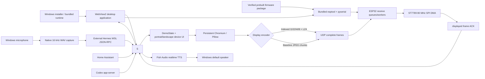

# ESPAgent 项目架构与实现状态

## 1. 产品目标

ESPAgent 是一个快速演示用的 AI 伴随终端：Windows PC 负责服务接入、UI 渲染、编码和语音，ESP32-S3 负责接收完整画面并驱动 240x320 或 320x240 ST7789 屏幕。当前优先保证可演示、可诊断和快速迭代，不在 ESP32 上运行浏览器或 AI 模型。

## 2. 当前架构



## 3. 已实现功能

### 3.1 Host 与 UI

- 可独立安装的 Windows WebView2 桌面应用，按总览、模块、助手、家居、显示、固件、设置和诊断组织产品任务。
- 安装包内置 Python 运行时、应用依赖、模块、显示资源和发行固件；用户配置与日志写入 `%LOCALAPPDATA%\ESPAgent`。
- 内置模块 Manifest、Registry、状态/动作 API、动态桌面导航和模块 ESP32 场景激活。
- 首个 `builtin.codex-usage` 模块通过持久 Codex app-server 显示额度窗口和认证状态。
- FastAPI 状态 API、健康检查、开发诊断页和横竖屏设备 UI。
- Hermes、Lights、Link、Codex 四个产品页；测试图和视频由 Pillow/OpenCV 提供。
- First Paper 是当前主线主题，中文/英文/数字字体角色独立配置；Second Editorial 已冻结并隐藏，仅作兼容保留。
- 90% 至 110% 缩放、Motion、Hinting 和中性 Gray AA。
- 持久 Chromium 截图器、状态快照、显示 worker 和进程树清理。
- Tone 默认关闭；原始色彩诊断图强制绕过 Tone。
- 固件页使用应用自带 esptool/pyserial、预编译镜像和 SHA-256 清单自动识别并烧录 ESP32-S3，不要求用户安装 ESP-IDF。
- Hermes、WSL、Home Assistant、Fish Audio 服务、模型和用户凭据不进入应用安装包，通过用户配置连接。

### 3.2 显示链路

- 默认完整帧 Indexed I2 + LZ4；支持 I1、I2、I4、I8 和保护色槽。
- MJPEG 使用 Baseline JPEG、1400 字节 UDP payload、`esp_new_jpeg 0.5.0` block decode。
- 两种模式运行时热切换，使用 `transport_epoch` 隔离旧包和旧 worker 结果。
- ESP32 使用独立接收任务、三接收帧缓冲、深度 2 的完整帧队列和逐帧 displayed ACK。
- ST7789 使用 80 MHz SPI DMA、两个局部缓冲和共享 LCD 互斥锁。
- Gamma 默认为 1.8；运行时 Gamma 命令与 LCD DMA 串行，避免快速切页卡死。

### 3.3 Hermes、语音和智能家居

- `HERMES_MODE=demo` 提供离线演示回复。
- `HERMES_MODE=real` 复用 WSL Hermes 常驻 JSON-RPC 会话，消费回复、工具和状态事件。
- 支持流式文本、创建新会话和协作式打断。
- 真实 Hermes 模式由 Windows Host 直接录制默认麦克风，再通过常驻 gateway 交给 Hermes STT；不依赖 WSL 音频转发。
- Fish Audio 只朗读最终回答事件，输出 44.1 kHz PCM 到 Windows 默认扬声器。
- Home Assistant adapter 支持一个灯具的开关、亮度和后台状态同步。

## 4. 未实现或非主线功能

| 项目 | 状态 |
|---|---|
| ESP32 音频接收和 I2S 播放 | 未实现 |
| VoxCPM2 本地 TTS | 未实现；当前 TTS 是 Fish Audio |
| Codex 额度状态 | 已实现为 `builtin.codex-usage` 模块 |
| 第三方模块安装、签名和强制权限 | 未实现；当前仅可信内置模块 |
| 触摸、按键和输入事件回传 | 未实现 |
| WebRTC 直连 ESP32 显示 | 非主线；遗留信令代码不构成可用显示方案 |
| RGB565 tile + NACK | 兼容/实验代码，不是产品默认路径 |
| PC 端直接输出最终索引 UI | 未实现；当前仍保留网页截图生态 |

## 5. 硬件和网络

```text
Board: ESP32-S3 with PSRAM
LCD: ST7789 IPS, 240x320 portrait or 320x240 landscape
SCL/SCLK GPIO 12（默认，可通过桌面应用 USB 设置）
SDA/MOSI GPIO 11（默认，可通过桌面应用 USB 设置）
CS GPIO 10（默认，可通过桌面应用 USB 设置）
DC GPIO 8（默认，可通过桌面应用 USB 设置）
RST GPIO 7（默认，可通过桌面应用 USB 设置）
BL GPIO 6（默认，可通过桌面应用 USB 设置）
Display UDP port 39000
Status UDP port 39001
```

屏幕数据为 RGB565 大端，面板颜色反转开启。背光通过当前 BL GPIO 的 LEDC PWM 控制。六个引脚保存在 NVS，启动时在创建 SPI、LCD 和 LEDC 之前读取；运行时不热重建显示总线。

外部 PSRAM 是当前显示主线的硬件要求。ESP32-S3 SuperMini 等无 PSRAM 设备不受桌面应用支持；Flash 容量不能替代运行内存。完整边界和重新接入门槛见[显示硬件支持策略](./hardware-support-policy.md)。

## 6. 关键代码

| 领域 | 位置 |
|---|---|
| Host 配置与状态 | `apps/demo_host/espagent_demo/config.py`, `state.py` |
| HTTP 与依赖装配 | `apps/demo_host/espagent_demo/server.py` |
| 模块运行时 | `module_runtime.py`, `modules/`, `codex_usage.py` |
| 桌面应用与打包 | `start_espagent_app.py`, `apps/demo_host/desktop_ui/`, `packaging/` |
| 内置固件烧录、USB 配网与屏幕引脚设置 | `firmware_flash.py`, `firmware/releases/esp32_display/`, `usb_wifi_provisioning.c`, `display_gpio_config.c` |
| 显示调度与发送 | `display_worker.py`, `udp_link.py` |
| Indexed 编码 | `indexed_rect.py` |
| Web/Pillow 渲染 | `web_renderer.py`, `renderer.py` |
| Hermes 与语音 | `hermes_adapter.py`, `native_audio.py`, `voice_input.py`, `fish_audio.py` |
| Home Assistant | `ha_adapter.py`, `ha_sync.py` |
| 固件接收与 worker | `firmware/esp32_display/main/udp_display.c` |
| LCD 驱动 | `firmware/esp32_display/main/lcd_display.c` |

## 7. 下一阶段边界

在继续产品功能前，应保持以下显示基线：双模式可热切换、同场景 A/B 不回退、帧 lag 通常为 0 至 2、稳定窗口错误增量为 0。视频、静态页和复杂功能页的编码成本不同，不用单一 FPS 数字替代同场景比较。新增模块、Hermes、灯具或语音 UI 不应持有显示状态锁执行网络、子进程等待、截图、编码或音频操作。模块扩展规则见 [模块开发指南](./module-development-guide.md)。

若接入 ESP32 音频，应建立独立音频协议、`audio_stream_id`、抖动缓冲和 I2S DMA；不要复用画面队列或把音频可靠性直接等同于图像 NACK。
