# ESPAgent

Windows 桌面应用 + ESP32-S3 小屏伴随终端。电脑负责界面渲染、服务接入与编码，ESP32-S3 通过局域网接收画面并驱动 ST7789 IPS 屏幕。

当前应用版本：`0.1.1`。项目仍处于原型阶段。

> **早期实验项目。** 当前实现简陋，主要用于个人探索、功能演示与原型验证，**不保证稳定运行、部署成功、跨设备兼容或长期维护**。文档、依赖和实际环境可能存在差异，安装、烧录及外部服务接入仍可能需要自行排查。请勿将其作为生产环境或关键设备的可靠控制方案。

## 实机展示

下面的照片与视频来自原始 `Other/img` 展示素材，经过尺寸优化及元数据清理。画面反映拍摄时的版本，部分文字、布局与当前代码可能不同；照片中的 FPS 仅代表当时的演示场景。

### 竖屏 · 240 × 320

<table>
  <tr>
    <td align="center" width="33%">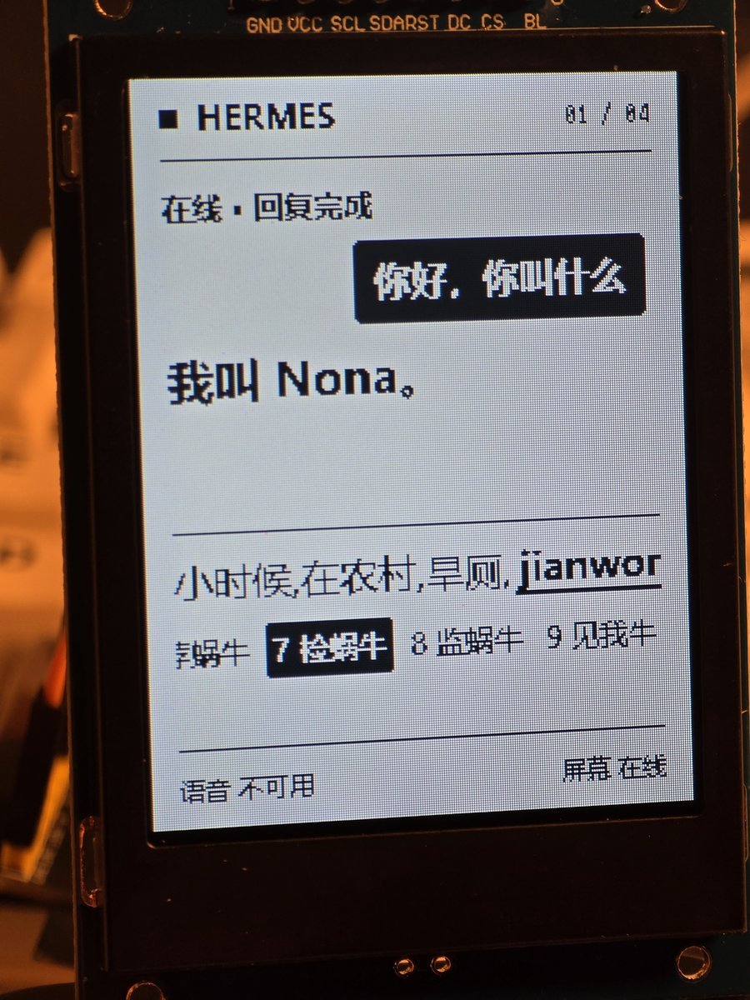<br><b>Hermes 助手</b><br>对话、输入与候选词</td>
    <td align="center" width="33%">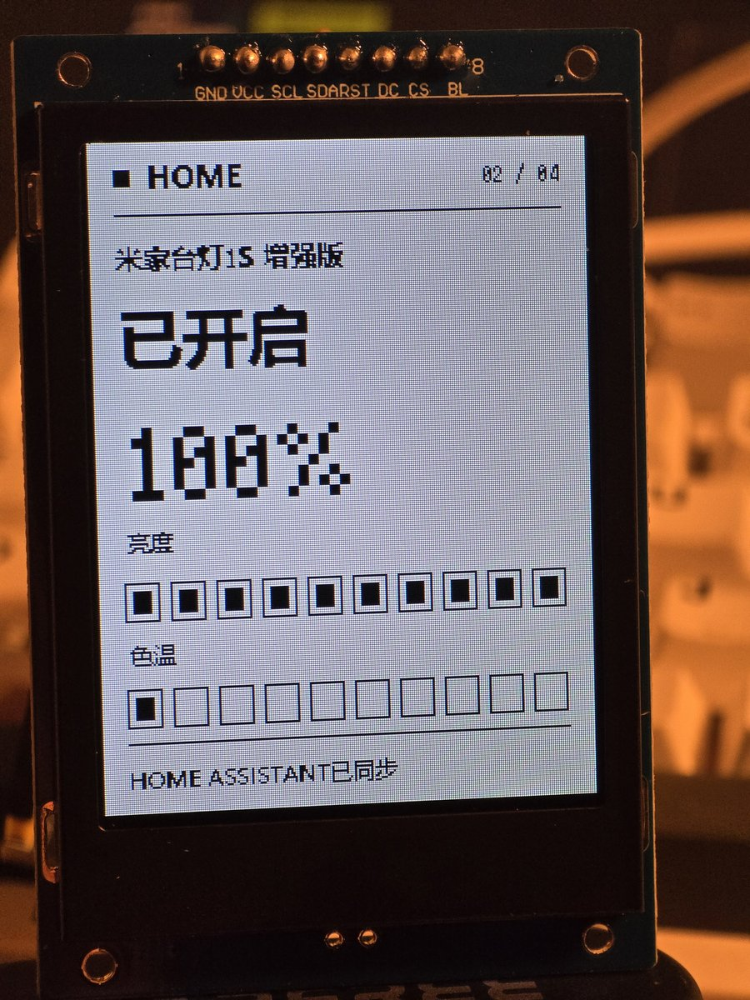<br><b>智能家居</b><br>灯具状态、亮度与色温</td>
    <td align="center" width="33%">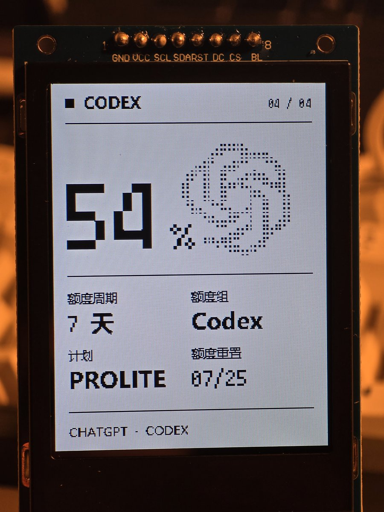<br><b>Codex 额度</b><br>额度窗口与剩余比例</td>
  </tr>
</table>

### 横屏 · 320 × 240

<table>
  <tr>
    <td align="center" width="50%">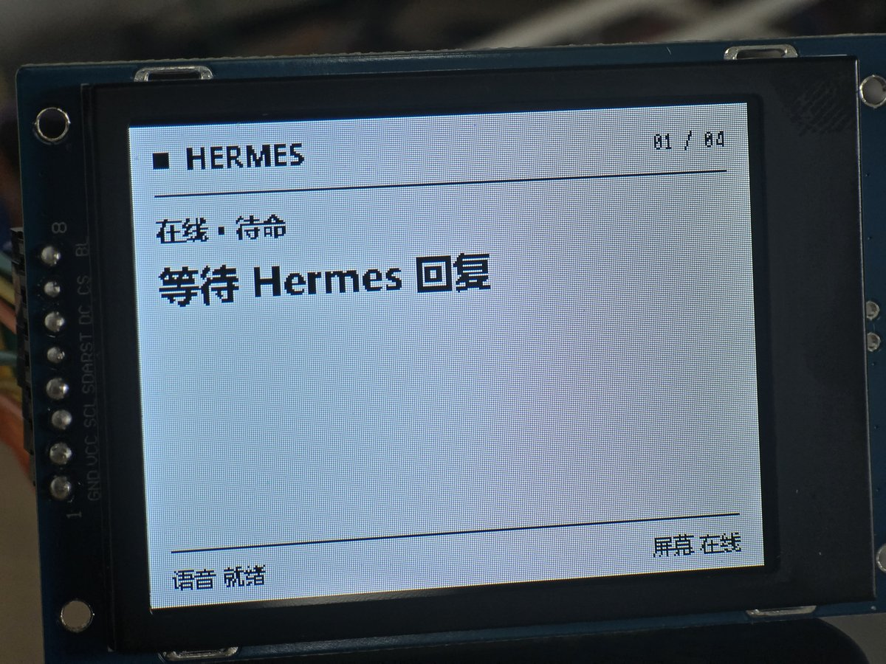<br>Hermes</td>
    <td align="center" width="50%">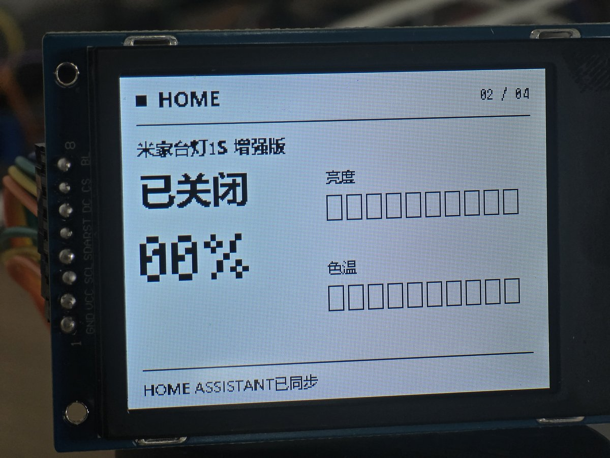<br>家居</td>
  </tr>
  <tr>
    <td align="center">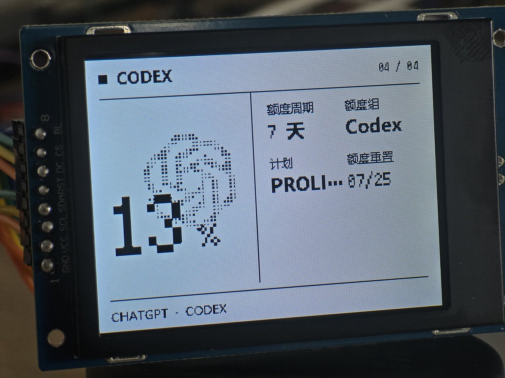<br>Codex</td>
    <td align="center">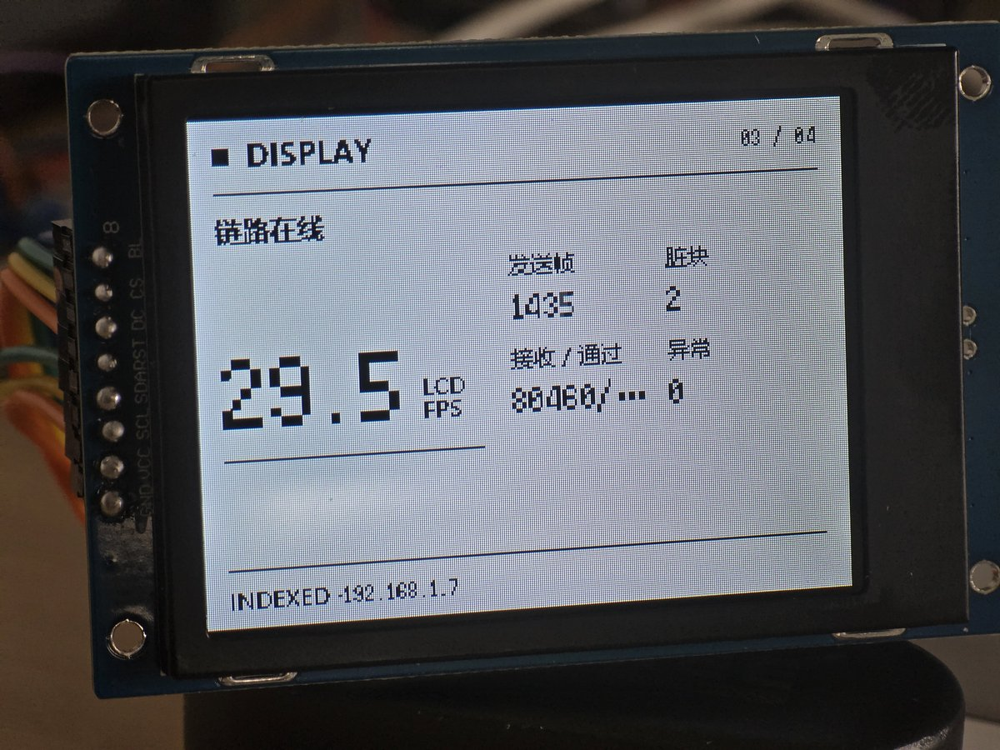<br>显示链路统计</td>
  </tr>
</table>

### 动态演示

GitHub README 通过动图展示片段；点击预览或下面的链接可打开完整 MP4。仓库中的演示视频为无声版本。

<table>
  <tr>
    <td align="center" width="50%"><a href="docs/media/color-stream.mp4">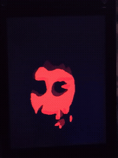</a><br><b>彩色视频串流</b> · <a href="docs/media/color-stream.mp4">完整视频</a></td>
    <td align="center" width="50%"><a href="docs/media/desktop-stream.mp4">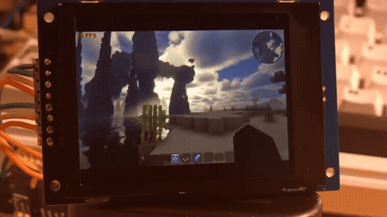</a><br><b>横屏画面串流</b> · <a href="docs/media/desktop-stream.mp4">完整视频</a></td>
  </tr>
  <tr>
    <td align="center"><a href="docs/media/home-demo.mp4">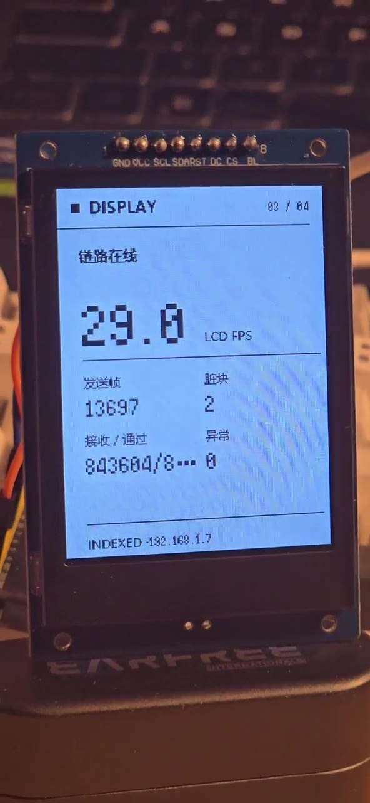</a><br><a href="docs/media/home-demo.mp4">竖屏家居页实拍</a></td>
    <td align="center"><a href="docs/media/game-stream.mp4">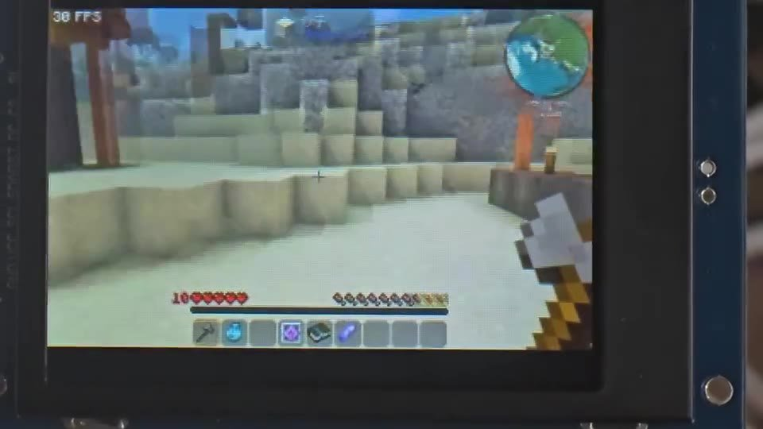</a><br><a href="docs/media/game-stream.mp4">游戏画面实拍</a></td>
  </tr>
</table>

<details>
<summary>更多显示测试：链路统计与色彩测试</summary>

<table>
  <tr>
    <td align="center" width="50%">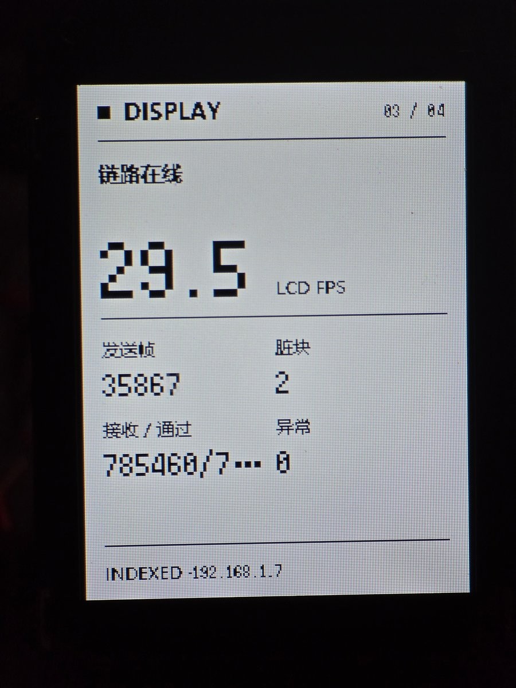<br>显示诊断</td>
    <td align="center" width="50%">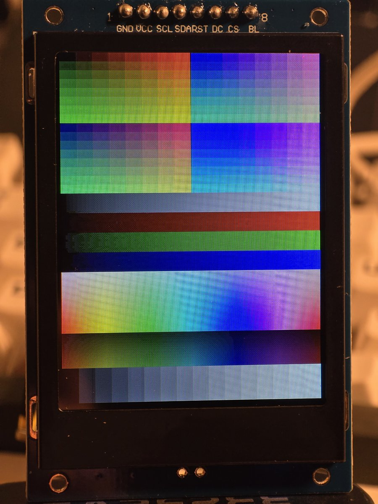<br>色彩测试</td>
  </tr>
</table>
</details>

## 当前具备的能力

| 部分 | 当前实现与边界 |
| --- | --- |
| Windows 桌面应用 | WebView2 桌面壳，含总览、模块、助手、家居、显示、固件、设置、诊断页 |
| 设备界面 | HTML/CSS/JavaScript 渲染，支持竖屏 240×320、横屏 320×240、像素字体与页面动效 |
| 显示传输 | 默认 Indexed I2 + LZ4，可选 I1/I2/I4/I8；支持与 MJPEG 热切换 |
| MJPEG | Baseline JPEG，质量与色度子采样可调，ESP32 使用 `esp_new_jpeg` block decode |
| 屏幕刷新 | ST7789、80 MHz SPI DMA、双局部缓冲、独立接收任务、完整帧队列、完成帧 ACK |
| Hermes | 内置 demo 回复；真实对话需要外部 WSL Hermes，支持流式回复、新会话与打断 |
| 输入与语音 | 全局快捷键、屏幕控制、输入法候选词同步；Windows 麦克风 + 外部 Hermes STT；Fish Audio 回复播报 |
| 智能家居 | Home Assistant 单灯具的开关、亮度、色温；需另行配置 HA 与 Token |
| 内置模块 | Codex 额度、桌面副屏、WS2812B/WLED 灯条控制 |
| 固件管理 | 端口发现、固件校验与烧录、USB 配网、自定义屏幕 GPIO；依赖完整且匹配的发行镜像 |

尚未实现 ESP32 端音频/I2S、完整第三方模块安装与签名机制、触摸/实体按键回传。遗留 WebRTC 或 tile 代码不代表当前可用的主线显示方案。

**语音识别和 TTS 当前在电脑端运行，小屏只是显示与交互终端。** 不接入外部 Hermes 时，可查看界面和 demo 回复，不能把 demo 当作真实 AI 或语音服务。

## 工作方式

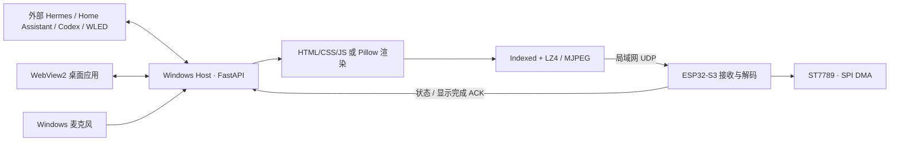

PC 端编码、浏览器截图、Wi-Fi、接收队列和 LCD 刷新都会影响流畅度；不同页面和视频的 FPS 不能直接等同比较。预览来自 Host 缓存，不是从 ESP32 回读的屏幕录像。

## 硬件与运行环境

- Windows 10/11，Python 3.11 或以上；项目此前使用 Python 3.12 开发。
- Microsoft WebView2 Runtime；设备网页渲染还需要可用的 Chrome 或 Edge。
- 带外部 **Octal PSRAM** 的 ESP32-S3，配套 ST7789 IPS 屏幕。
- PC 与 ESP32 位于可互通的局域网，允许 UDP `39000`、`39001`；PC 本地 HTTP 默认 `8787`。
- 修改固件需要 ESP-IDF；当前依赖锁记录的开发版本为 `5.4.1`。

默认屏幕接线：

| 屏幕信号 | GPIO |
| --- | --- |
| SCL / SCLK | 12 |
| SDA / MOSI | 11 |
| CS | 10 |
| DC | 8 |
| RST | 7 |
| BL | 6 |

引脚可在应用中通过 USB 修改并保存到 NVS，按实际接线和面板要求使用。**无外部 PSRAM 的 SuperMini 不支持主显示固件**；它作为独立 WLED 灯条控制器是另一种用途。

## 从源码尝试运行

先克隆本仓库，在项目根目录执行：

```powershell
py -3 -m venv apps\demo_host\.venv
.\apps\demo_host\.venv\Scripts\python.exe -m pip install -r requirements.txt
Copy-Item apps\demo_host\.env.example apps\demo_host\.env.local
.\apps\demo_host\.venv\Scripts\python.exe start_espagent_app.py
```

示例配置不包含真实凭据，默认 `HERMES_MODE=demo`。也可运行 `start_espagent_app.cmd --console`，观察环境安装和启动信息。源目录名中的 `demo_host` 是保留的开发目录名，产品入口为桌面应用。

仅启动后端进行开发检查：

```powershell
.\apps\demo_host\.venv\Scripts\python.exe start_demo_host.py --host 127.0.0.1
```

| 入口 | 地址 |
| --- | --- |
| 桌面界面 | `http://127.0.0.1:8787/app/` |
| 开发诊断 | `http://127.0.0.1:8787/debug/` |
| 设备 UI | `http://127.0.0.1:8787/screen/` |
| API 文档 | `http://127.0.0.1:8787/docs` |

固件源码在 `firmware/esp32_display`，不是项目根目录：

```powershell
Set-Location firmware\esp32_display
# 先按本机 ESP-IDF 安装方式激活环境，再执行：
idf.py set-target esp32s3
idf.py build
idf.py flash
```

固件默认不写入 Wi-Fi 名称和密码，首次使用需 USB 配网。应用内烧录所需镜像与 SHA-256 清单放在 `firmware/releases/`；第三方 WLED 另有来源和许可说明。

## 外部服务与分发范围

仓库提供 **ESPAgent 应用本体、内置模块、显示固件源码、经过检查的发行资源与项目文档**，不包含 Hermes/WSL 实例、Home Assistant 配置、AI 模型、账户登录数据、个人 `.env.local`、密钥、Wi-Fi 凭据、日志或本机虚拟环境。GitHub 首次发布采用当前源码快照，不包含本机旧开发历史。

真实服务需要自己安装并接入；配置字段见 [`.env.example`](apps/demo_host/.env.example)。不要把配置中的 Token、Key、密码或 Codex 认证文件提交到 Git。应用当前面向本机及可信局域网，HTTP/显示协议不是可直接暴露公网的服务。

安装包构建入口为 [`packaging/build_windows.ps1`](packaging/build_windows.ps1)。需要 PyInstaller、Inno Setup、WebView2 及打包资源；公开源码不包含现成 Windows 安装包。`test/video/test.mp4` 可由用户自行放置测试素材，缺少时视频测试不会播放；README 中的演示视频仅用于项目展示。

## 开发与文档

```text
apps/demo_host/desktop_ui/       桌面界面
apps/demo_host/display_ui/       ESP32 功能页的网页源文件
apps/demo_host/espagent_demo/    Host、协议、渲染、服务适配与输入
apps/demo_host/modules/          Codex、桌面副屏、灯条模块
apps/demo_host/hermes_skills/    ESPAgent 灯条控制 skill
firmware/esp32_display/          ESP32-S3 显示固件源码
firmware/releases/               发行固件与校验清单
Documents/                      架构、操作、显示链路与开发经验
docs/media/                     README 展示资源
packaging/                      Windows 打包脚本
```

- [项目文档索引](Documents/README.md) · [架构与实现状态](Documents/project-architecture-and-status.md)
- [桌面应用与日志](Documents/desktop-app-guide.md) · [运行手册](Documents/demo-runbook.md)
- [显示传输与刷新](Documents/display/README.md) · [硬件支持范围](Documents/hardware-support-policy.md)
- [模块开发](Documents/module-development-guide.md) · [语音链路](Documents/audio/fish-audio-hermes-streaming-guide.md)
- [灯条控制](Documents/ws2812b-module-guide.md) · [固件烧录](Documents/firmware-flashing-guide.md)

源码测试：

```powershell
.\apps\demo_host\.venv\Scripts\python.exe -m pip install pytest
.\apps\demo_host\.venv\Scripts\python.exe -m pytest -q apps/demo_host/tests
```

已有自动测试不代表所有真实硬件、网络、外部服务和部署路径都通过验证。本项目不承诺固定帧率或在其他电脑上一键部署成功。

第三方字体、固件和其他依赖遵循各自许可，见 [第三方资源说明](THIRD_PARTY_NOTICES.md)。目前未为 ESPAgent 自有代码指定项目级开源许可证，公开可见不等于授予任意再分发或商用许可。
